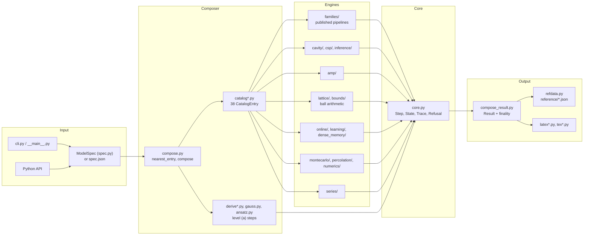
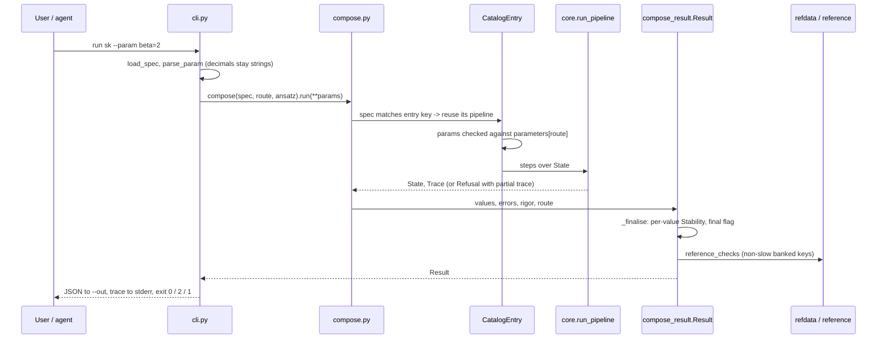

# Architecture Overview

This page covers the internal structure of `tools/replicant/`: how a request becomes a recorded
calculation and a labelled result. The surrounding harness is described in
[BootLoops Host Repository](BootLoops-Host-Repository).

## Design principles in current implementation

1. **A calculation is a sequence of `Step`s over an immutable `State`.** `core.run_pipeline` checks each step's `requires`, applies it, and records a `TraceEntry` with its citation. `State.with_` returns a copy, so a step can never mutate an earlier state behind the trace's back.
2. **Fail closed, by name.** A missing precondition raises `Refusal("precondition:<name>")`. The refusal carries the partial trace (`refusal.trace`) and the refusing step (`refusal.step`), so a refused calculation can still be written out as LaTeX.
3. **Finality is per value, not per run.** Each entry declares a `Stability` for every physical value key. Only `stable` and `exact-by-literature` are final (`catalog.FINAL_STATES`). See [Results, Finality and Refusals](Results-Finality-and-Refusals).
4. **No number from memory.** Banked reference values come from fetched sources, at the source's printed precision. Each needs a `cite` and an `independent_route`, or loading refuses (`unbanked:no-citation`, `unbanked:no-independent-route`). See [Reference Store and Provenance](Reference-Store-and-Provenance).
5. **Rigor is stated, not implied.** `Result.rigor` is `physics-level`, `certified` or `statistical`. `certified` is used only for true ball enclosures (python-flint arb through `tools/baller`), and it certifies the evaluation, not the cited theorem.
6. **Independent checks share no code with the route they check.** The finite-N simulators (`online/simulate*.py`, `amp/`, `numerics/`) and the exact enumerations do not import the code they check. Planted controls show that each check can fail.
7. **A correct sampler is never refused at runtime.** When a diagnostic fails, the affected values are labelled `undetermined` and the rest are kept. Only explicit out-of-range requests are refused. An undetermined run never feeds an asserted reference band.

## Main module boundaries

- `core.py`, `spec.py`, `testing.py`: steps, state, trace, `Refusal`, `ModelSpec`, the `@slow` marker.
- `catalog.py`, `catalog_*.py`: `CatalogEntry`, `RefCheck`, `Stability`, the catalog and its banked comparisons (`compare`, `run_cached`).
- `compose.py`, `compose_result.py`, `compose_rsb.py`: the composer, `Result`, the finality rule `_finalise`, the level-(a) 1RSB route.
- `derive*.py`, `gauss.py`, `gauss_rsb.py`, `ansatz.py`, `agree.py`, `solve*.py`: level (a), the symbolic derivation and its solvers, the derived replicon and the 1RSB functional.
- `families/`: level (b), the published pipelines: SK, REM, p-spin, perceptron (with `margin_law.py`, `perceptron_rsb.py`, `perceptron_krsb.py`), teacher-student, Hopfield, Parisi full RSB, `gardner.py`.
- `cavity/`, `csp/`, `inference/`: dense and sparse cavity, K-XORSAT and K-SAT, LDPC codes on the BEC, spiked Wigner, the SBM.
- `amp/`: AMP, state evolution and TAP for SK; GAMP for the teacher-student perceptron.
- `lattice/`, `bounds/`: certified solvable lattices and Guerra's bounds.
- `series/`: the exact 2D Ising series and its holonomic operator through `tools/annihilator`.
- `online/`, `learning/`, `dense_memory/`: online-learning ODEs, ridge regression, dense associative memories.
- `percolation/`, `montecarlo/`, `numerics/`: percolation (certified cavity and sampled routes), cluster / flat-histogram / population-annealing Monte Carlo, held-out enumeration and parallel tempering.
- `pinned*.py`, `derive_pinned.py`: the perceptron with pinned directions and its joint replicon.
- `refdata.py`, `reference/`: the reference store.
- `latex*.py`, `tex*.py`, `derive_tex.py`: the LaTeX writer.
- `cli.py`, `__main__.py`: the command line.
- `selftest.py`, `tests/`: the battery.

## Typical run

## Related pages

- [Derivation and Composer](Derivation-and-Composer)
- [Results, Finality and Refusals](Results-Finality-and-Refusals)
- [Catalog and Routes](Catalog-and-Routes)
