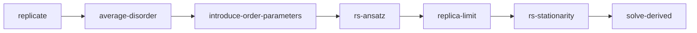

# Derivation and Composer

`replicant` works at two levels. Level (b) runs the published pipelines of the catalog. Level (a)
is a symbolic derivation for a model the user describes. The composer (`compose.py`) chooses
between them and reports what it reused, what it adapted and what it could not do.

## ModelSpec

A model is described declaratively by `spec.ModelSpec` (frozen dataclass):

| Field | Known values |
|---|---|
| `family` | e.g. `sk`, `perceptron`, `hopfield` (level-(a) hooks), plus every catalog family |
| `variables` | `ising`, `spherical` |
| `disorder` | `gaussian`, `pm_one`, `none` |
| `constraint` | optional, e.g. a margin constraint |
| `prior` | optional |
| `params` | run parameters, not part of the match |

The value sets are deliberately not enforced in `spec.py`: the set is open to extension, and each
step refuses what it cannot handle. A spec is frozen but not hashable, because `params` is a dict.
On the CLI, a spec is a JSON file: `python3 -m replicant run spec.json --param beta=1.5`.

## Matching

A spec is a catalog entry when its structural key (`family`, `variables`, `disorder`,
`constraint`, `prior`) equals the entry's key. In that case the entry's pipeline for the route is
reused whole: `report.reused` lists its step names, and `adapted` and `missing` are empty.

`nearest_entry(spec)` picks, among the entries of the same family, the one that agrees on most of
(`constraint`, `prior`). Ties are broken by agreement on (`variables`, `disorder`), then by
catalog order.

## Level (a): the symbolic derivation

Any other spec is assembled from the level-(a) steps, through the registered hooks
`derive.FAMILIES`, `derive.SITES` and `derive.LAWS`:

For a composed model, the report is written relative to the level-(a) derivation of the nearest
entry's spec (`report.relative_to`). Both step lists are built (`level_a_steps`). Step by step, the
composer compares the registry objects that each step's code resolves (`hooks_used`): the Family
hook, the SITES entry, the LAWS entry, the constraint or prior, and the solver's discrete-variable
rule. A step is **adapted** when any of them differs (the `Adaptation` names the hook now used,
e.g. `disorder:pm_one`) and **reused** otherwise.

A hook that does not exist is a refusal, never a partial result:

| Refusal | Meaning |
|---|---|
| `missing-step:family:<f>` | no `derive.FAMILIES` hook (detail: what exists, the nearest entry) |
| `missing-step:site:<v>` | the family has no hook for these variables |
| `missing-step:disorder:<d>` | the family's average does not handle this law |
| `missing-step:constraint:<c>`, `missing-step:prior:
` | not implemented by the hooks |
| `missing-step:route:<r>` | unknown route, or cavity / amp for a composed spec (there is no generic cavity or AMP composer) |

## 1RSB at level (a)

`compose(spec, route, ansatz="1rsb")` (`compose_rsb.py`) takes any spec with level-(a) hooks to
the 1RSB functional (`derive_rsb*.py`, `gauss_rsb.py`, `solve_derived_rsb.py`). For a catalog
spec, `ansatz` keeps its meaning as an entry parameter. To send even a catalog spec to the
level-(a) 1RSB solver, use `level_a_ansatz=1rsb` on the CLI. `cli.build_result` implements this
distinction.

## Derived replicon

`derive_replicon*.py` derives the RS stability (the replicon) symbolically for SK, the perceptrons
and Hopfield. A composed model whose energy or site has no replicon rule gets `stable: null`,
which means **unknown**, not "fine".

## Related pages

- [Architecture Overview](Architecture-Overview)
- [Results, Finality and Refusals](Results-Finality-and-Refusals)
- [LaTeX Derivation Writer](LaTeX-Derivation-Writer)
